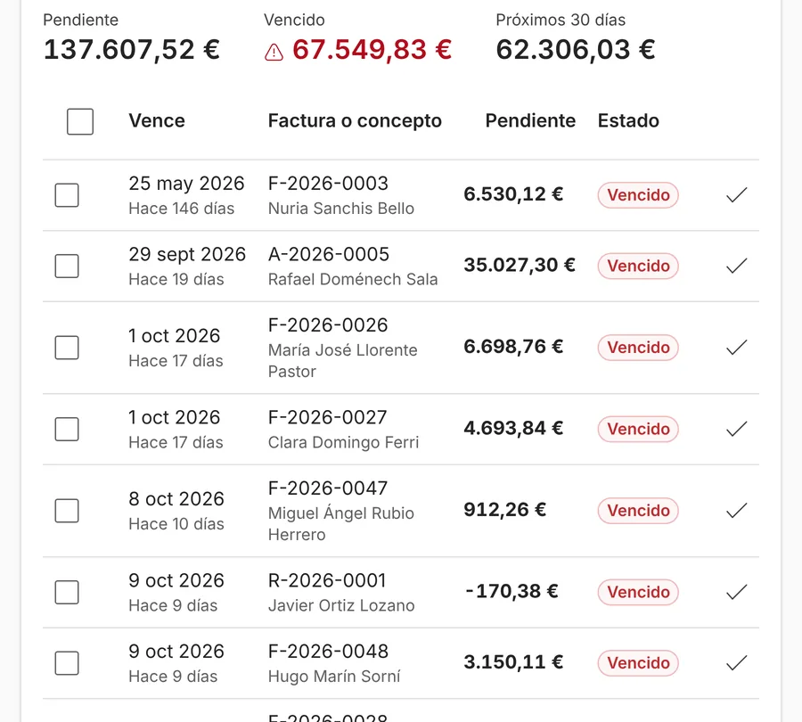

**En una reforma no se suele facturar todo al final: se cobra un anticipo al firmar, se certifica lo hecho durante la obra y se cierra con una factura final.** Cada certificación se calcula «a origen»: todo lo hecho desde el principio menos lo que ya facturaste antes, descontando la parte del anticipo que corresponde. Así no adelantas tú el dinero de la obra y el cliente paga por lo que ve hecho.

## Las tres facturas de una reforma

1. **Anticipo**, al firmar: una parte del precio por adelantado, para pagar el material y empezar. El porcentaje se pacta con el cliente.
2. **Certificaciones**, durante la obra: facturas de lo ejecutado hasta ese momento.
3. **Factura final**, al terminar: lo que quede, con el resto del anticipo descontado.

## Qué es certificar «a origen»

Certificar a origen es medir **todo** lo hecho desde que empezó la obra, no solo lo de este mes, y restar lo que ya certificaste antes. Tiene una ventaja: si en una certificación te equivocaste, la siguiente lo corrige sola, porque siempre se parte del total.

La cuenta de cada certificación es esta:

| Paso | Cuenta |
| --- | --- |
| 1 | Lo ejecutado a origen (todo lo hecho hasta hoy) |
| 2 | Menos lo certificado antes |
| 3 | = Lo de esta certificación |
| 4 | Menos la parte del anticipo que toca descontar |
| 5 | = Lo que facturas ahora, más IVA |

## Un ejemplo: reforma de un baño

Datos de ejemplo, inventados. Sin IVA.

La obra vale 8.000 € y se pacta un anticipo del 30 %: 2.400 €. A mitad de obra, el cliente pide un plato de ducha más grande y una mampara mejor: un extra de 600 €, que aprueba por escrito. La obra pasa a valer 8.600 €.

| Factura | Cuenta | Importe |
| --- | --- | --: |
| Anticipo, al firmar | 30 % de 8.000 € | 2.400 € |
| Certificación 1, a mitad de obra | Ejecutado 4.000 € − anticipo descontado 1.200 € (la mitad, porque la obra va por la mitad) | 2.800 € |
| Factura final | Resto de la obra con el extra, 4.600 € − resto del anticipo 1.200 € | 3.400 € |
| **Total facturado** | 2.400 + 2.800 + 3.400 | **8.600 €** |

El total coincide con lo que vale la obra con el extra. Si no coincide, algo se ha facturado dos veces o se ha quedado sin facturar.

## El IVA del anticipo

El IVA de un anticipo se devenga cuando lo cobras, y solo por lo que has cobrado: hay que declararlo en el trimestre del cobro, aunque la obra no haya empezado. Lo dice el [artículo 75.Dos de la Ley del IVA](https://www.boe.es/buscar/act.php?id=BOE-A-1992-28740). Por eso el anticipo lleva su propia factura, como pide el [Reglamento de facturación](https://www.boe.es/buscar/act.php?id=BOE-A-2012-14696) para los pagos recibidos antes de hacer el trabajo, y en las certificaciones siguientes se descuenta.

El tipo de IVA depende de cada obra. El general es el 21 %. El 10 % se aplica a obras de renovación o reparación de la vivienda de un particular (o de una comunidad de propietarios) si la vivienda se terminó hace más de dos años, si el coste del material que pones tú no pasa del 40 % del precio sin IVA y si el cliente paga con tarjeta, transferencia, cheque nominativo o ingreso en tu cuenta ([artículo 91.Uno.2.10.º de la Ley del IVA](https://www.boe.es/buscar/act.php?id=BOE-A-1992-28740)).

Si trabajas como subcontrata de otra empresa en una obra de construcción o rehabilitación de un edificio, o directamente para el promotor de esa obra, en muchos casos la factura va sin IVA: lo declara tu cliente (inversión del sujeto pasivo, artículo 84.Uno.2.º f de la Ley del IVA). Confírmalo con tu gestoría.

## La retención de garantía

Con comunidades de propietarios y empresas es frecuente pactar una **retención de garantía**: el cliente no te paga ahora un porcentaje de cada factura (por ejemplo, un 5 %) y te lo paga cuando termina el plazo de garantía acordado.

Dos consejos:

- **Que esté en el contrato**: el porcentaje y el plazo, por escrito.
- **Apunta la fecha de cobro.** Un año después nadie se acuerda, y ese dinero es tuyo.

## Errores frecuentes

- **No descontar el anticipo** en las certificaciones, y que el cliente lo detecte en la factura final.
- **Certificar solo «lo de este mes»** sin partir del total: los errores se van acumulando.
- **Hacer los extras de palabra.** Si no están aprobados por escrito, no entran en la certificación y cuesta cobrarlos.
- **Dejar pasar meses sin certificar.** Si haces mucha obra sin facturarla, estás financiando a tu cliente con tu dinero.

## Cómo se ve en un programa de gestión

En ModernERP, desde la obra pulsas «Certificar» y el programa prepara la relación valorada: por cada partida, lo ejecutado a origen según el avance, lo certificado antes y lo de esta certificación, con la parte del anticipo descontada. Cada factura crea sus cobros pendientes, y ves en una pantalla lo que te deben, lo vencido y lo que vence en los próximos 30 días. Si pones una retención de garantía, queda como un cobro pendiente con su fecha.

Para que las certificaciones salgan bien, el presupuesto tiene que estar hecho por partidas: lo explicamos en [cómo hacer un presupuesto de reforma por partidas](/articulos/presupuesto-reforma-por-partidas/). Y para saber si la obra deja dinero mientras la certificas, [cómo calcular el margen real de una obra](/articulos/margen-real-obra-reforma/).

## Fuentes

Consultadas el 18 de octubre de 2026.

- [Ley 37/1992 del Impuesto sobre el Valor Añadido](https://www.boe.es/buscar/act.php?id=BOE-A-1992-28740), artículos 75.Dos, 84.Uno.2.º f y 91.Uno.2.10.º (BOE, texto consolidado).
- [Real Decreto 1619/2012](https://www.boe.es/buscar/act.php?id=BOE-A-2012-14696), Reglamento de facturación, artículo 2.1 (BOE, texto consolidado).
