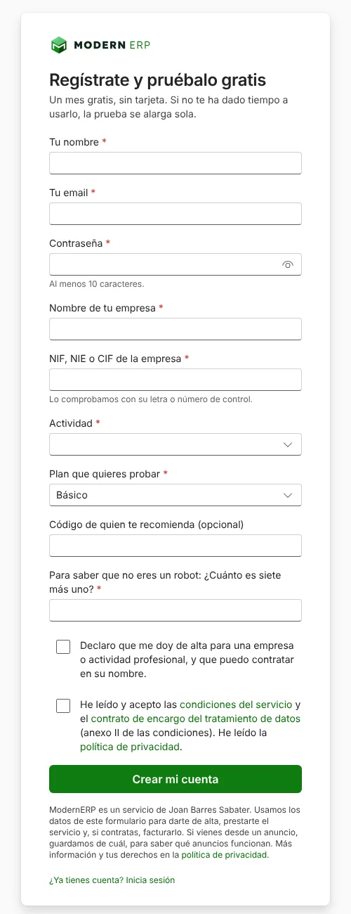
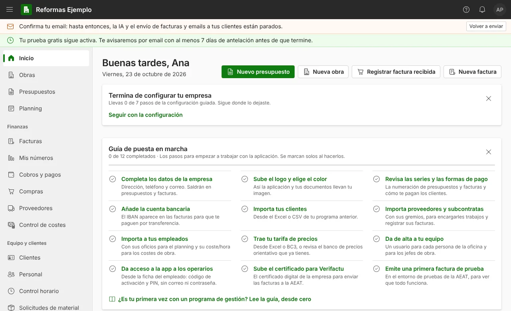

**Para darte de alta en ModernERP, entra en [modern-erp.es](/), pulsa «Regístrate y pruébalo gratis» y rellena un formulario corto con tu nombre, tu email, el nombre y el NIF de tu empresa y el plan que quieres probar. Entras al momento, sin esperar a nadie.** La prueba dura un mes, es gratis y no pide tarjeta ni permanencia. Después, la **configuración guiada** te deja la empresa lista en 7 pasos, y puedes hacerla de una vez o en varios días.

Esta guía explica cada paso con las pantallas reales del programa, qué conviene tener a mano y qué hacer los primeros días para que la prueba te sirva de verdad.

## Qué necesitas antes de empezar

Para registrarte, solo esto:

- Un **email** que mires a menudo: ahí te llega el enlace para confirmar la cuenta.
- El **nombre y el NIF, NIE o CIF** de tu empresa. Si eres autónomo, tu NIF.
- Saber qué **plan** quieres probar: **Fotos** o **Básico** (los dos se prueban gratis; ver más abajo).

Para dejar la empresa lista (no hace falta el primer día):

- Tu **logo**, en PNG, JPG o WebP de hasta 2 MB.
- El **IBAN** de la cuenta donde te pagan.
- Tus listas en Excel, si las tienes: **clientes, proveedores, trabajadores y tarifa de precios**. También sirven ficheros BC3 de Presto, Arquímedes o Menfis, y presupuestos antiguos en PDF.
- Tu **certificado digital**, solo cuando quieras facturar en real (no hace falta para probar).

## Paso 1: crea tu cuenta

En la portada de [modern-erp.es](/), pulsa **Regístrate y pruébalo gratis**. También puedes ir directo al [formulario de registro](https://erp.modern-erp.es/registro).

Estos son los campos:

| Campo | Qué poner |
| --- | --- |
| Tu nombre | El de la persona que va a llevar la cuenta. Entras como gerente. |
| Tu email | El tuyo de siempre o el de la empresa. Los de correo temporal no se admiten. |
| Contraseña | Al menos 10 caracteres. |
| Nombre de tu empresa | El nombre con el que trabajas. La razón social se completa después. |
| NIF, NIE o CIF de la empresa | El programa comprueba la letra o el número del final. |
| Actividad | Reformas, construcción, fontanería, electricidad, climatización, carpintería, pintura, instalador u otra relacionada. |
| Plan que quieres probar | Fotos o Básico. |
| Código de quien te recomienda | Opcional, si otra empresa te ha pasado su código. |

Al final hay una pregunta sencilla para comprobar que no eres un robot y dos casillas: una para declarar que te das de alta para una empresa o actividad profesional y puedes contratar en su nombre, y otra para aceptar las condiciones del servicio y el contrato de encargo del tratamiento de datos. Las dos tienen el enlace al texto completo. Pulsa **Crear mi cuenta** y ya estás dentro.

### Fotos o Básico: cuál probar

| Plan | Para quién | Qué incluye | Precio después de la prueba |
| --- | --- | --- | --: |
| Fotos | Autónomos e instaladores que quieren tener al día facturas, gastos y fichajes | Fotos de facturas y tickets, facturas con Verifactu, fichajes desde el móvil y resumen de lo que entra y lo que sale. 3 personas | 19 €/mes, IVA incluido |
| Básico | La empresa de reformas que quiere llevarlo todo | Todo lo del Fotos, más presupuestos por partidas, obras con su coste y margen, trabajos extra, planning, compras, subcontratas, documentos, cobros y pagos e informes. 5 personas | 39 €/mes, IVA incluido |

Si haces presupuestos y quieres saber cuánto ganas en cada obra, prueba el **Básico**. El plan **Completo** (79 €/mes, IVA incluido), con el asistente de IA, no tiene prueba gratis: te lo enseñamos en una demo de 20 minutos por videollamada. Todos los planes están en la [tabla de precios](/#precios).

## Paso 2: confirma tu email

Al crear la cuenta te llega un email de bienvenida con un enlace para confirmar tu dirección. **Ábrelo en los primeros 7 días**: si no, la cuenta se desactiva.

Mientras no lo confirmes, puedes usar casi todo, pero hay dos cosas paradas: **la IA** (también la de la configuración guiada) y **el envío de facturas y emails a tus clientes** desde el programa. Arriba de la pantalla verás el aviso «Confirma tu email», con un botón para que te lo volvamos a enviar. Si no lo encuentras, mira en la carpeta de spam.

## Paso 3: la configuración guiada

Al entrar, el **Inicio** te avisa: «Termina de configurar tu empresa». Pulsa **Seguir con la configuración**. También está en **Ajustes › Configuración guiada**.

Son 7 pasos y un resumen, uno cada vez:

| Paso | Qué se hace | Consejo |
| --- | --- | --- |
| 1. Datos de la empresa | Razón social, nombre comercial, dirección y logo. Salen en tus presupuestos y facturas. | El NIF es el del registro. Si está mal, escríbenos antes de facturar. |
| 2. Cobros e IVA | Tu IBAN, cómo te pagan los clientes y el IVA que usas normalmente. | En reformas de vivienda suele ser el reducido del 10 %, si se cumplen sus requisitos (ver [IVA del 10 % en reformas](/articulos/iva-reformas-vivienda-10/)). |
| 3. Series | La numeración de presupuestos y facturas. Ya vienen creadas. | Si vienes de otro programa, cambia el siguiente número antes de la primera factura. |
| 4. Banco de precios | Sube tu tarifa o tus presupuestos (Excel, BC3, PDF o foto), parte de la plantilla que ya trae o sáltalo. | Los precios de la plantilla son orientativos: revisa al menos la mano de obra y los materiales que más usas. |
| 5. Textos | El pie legal de tus documentos y las condiciones de tus presupuestos: forma de pago, garantía y validez. | Cuéntale a la IA cómo trabajas y te propone los textos. |
| 6. Trabajadores y usuarios | Tu equipo y quién entra en el programa, con su rol. | Pon el coste por hora de cada trabajador: sin él, las horas no cuentan como coste de la obra. |
| 7. Verifactu | Tu certificado digital y el envío real de tus facturas a Hacienda. | Puedes dejarlo para cuando vayas a facturar en real. |
| Resumen | Lo que tienes listo y lo que falta. | Pulsa **Terminar la configuración**. |

Cada paso se guarda con **Guardar y seguir**. Si uno no te toca ahora, **Saltar este paso**. Puedes dejarlo en cualquier momento y seguir otro día donde lo dejaste.

### Lo que hace la IA en la configuración

En los pasos 4 y 5, la IA hace el trabajo pesado: lee tu tarifa o tus presupuestos en PDF y los convierte en partidas, propone familias y precios de venta con el margen que digas, y redacta los textos de tus documentos. **Siempre es una propuesta**: la revisas, la cambias si quieres y solo se guarda cuando tú lo confirmas.

Esta IA va aparte de la de tu plan, así que la tienes también en el Fotos y en el Básico, y funciona en cuanto confirmas tu email. Si no está disponible, todo se puede rellenar a mano. No le pongas nombres de clientes ni de trabajadores: no los necesita. Y si subes presupuestos antiguos, quítales antes los datos del cliente.

## Paso 4: trae tus datos de Excel

No escribas uno a uno tus clientes, proveedores o trabajadores. En **Ajustes › Importar datos** subes un fichero cada vez:

1. Elige qué vas a importar. Si no tienes fichero, descarga la **Plantilla**: un Excel con los títulos de columna y una fila de ejemplo.
2. Sube tu Excel (.xlsx), CSV o BC3. El programa propone qué columna es cada dato; revisa las que pone «Propuesta».
3. Haz primero un **Simulacro**: lo prueba todo sin guardar nada y te enseña las filas con errores (un NIF con la letra mal, un IBAN incorrecto, filas repetidas).
4. Pulsa **Importar**. Si algo sale mal, **Deshacer esta importación** lo quita.

Un orden que funciona: clientes y precios primero, después los presupuestos nuevos, luego las obras en marcha y, en cuanto puedas, las facturas. No hace falta pasarlo todo el primer día.

## Paso 5: da acceso a tu equipo

- **Personas de la oficina y jefes de obra**: en **Ajustes › Usuarios**, un usuario por persona, con su rol (gerente, administración, jefe de obra o encargado). Cada uno ve solo lo que le toca.
- **Operarios**: no necesitan correo ni contraseña. En **Personal**, abre la ficha del trabajador › **Acceso a la app** › **Generar código de activación**. El operario escanea el código con el móvil, elige su PIN y ya puede fichar al llegar a la obra, ver dónde va cada día y hacer fotos a los tickets.

Recuerda cuántas personas incluye tu plan: 3 en el Fotos y 5 en el Básico.

## Paso 6: haz algo de verdad la primera semana

La prueba sirve si la usas con algo tuyo. Elige una de estas cosas para los primeros días:

- **Un presupuesto** de una obra que tengas pendiente, con tu banco de precios (cómo se hace, en [presupuesto de reforma por partidas](/articulos/presupuesto-reforma-por-partidas/)).
- **Una obra** en marcha, con tu equipo fichando desde el móvil (en [control horario en obra](/articulos/control-horario-trabajadores-obra/) se explica qué pide la ley).
- **Una foto a un ticket** de material desde el móvil, para ver cómo se apunta el gasto en su obra.

Un consejo de Joan: no intentes configurarlo todo antes de usarlo. Haz el registro y los pasos 1 y 2 de la configuración, y prueba con un presupuesto real ese mismo día. Lo demás lo vas completando cuando lo necesites.

## Verifactu: facturas de prueba y facturas reales

Tu empresa empieza en el **entorno de pruebas** de Hacienda. Las facturas que hagas ahí llevan «PRUEBA» en el número y el sello «Prueba · sin validez fiscal»: sirven para aprender, **pero no se las puedes dar a tus clientes**, y no gastan números de tu serie.

Cuando quieras facturar en real, en el paso 7 de la configuración subes tu certificado digital y activas el envío real. Desde ese momento, ModernERP funciona en la modalidad VERI\*FACTU: cada factura se envía a Hacienda al momento, con tu certificado digital, y sale con su código QR. Las facturas no se pueden cambiar ni borrar: si te equivocas, haces una rectificativa o la anulas desde el propio programa.

La norma fija 2027, pero Hacienda ha anunciado que lo aplaza hasta octubre de 2028. Lo explicamos en [Verifactu: ¿2027 o 2028?](/articulos/verifactu-2027-o-2028/). ModernERP cumple Verifactu: puedes ver la [declaración responsable](https://erp.modern-erp.es/declaracion-responsable).

## Cuánto dura la prueba y qué pasa al acabar

- La prueba dura **un mes**. Si en ese mes no te ha dado tiempo a usarlo lo suficiente, **se alarga sola**. Arriba de la pantalla ves cuánto te queda y, en «Lo que cuenta para la prueba», qué cosas faltan.
- **Te avisamos por email con al menos 7 días de antelación** antes de que termine.
- Si sigues, eliges tu plan y pagas cada mes, **sin permanencia**.
- Si no sigues, la cuenta se desactiva ese día y tus datos se borran a los 30 días (a los 60 si emitiste facturas con el envío real a Hacienda). Mientras tanto puedes **pedirnos una copia** de todo lo que has metido.

## Si prefieres que te lo enseñemos

Si no quieres hacerlo solo, te lo enseñamos en una videollamada de 20 minutos, con una obra de ejemplo o con algo tuyo. Escríbenos por WhatsApp desde la [portada](/) o al email [contacto@modern-erp.es](mailto:contacto@modern-erp.es), de lunes a viernes de 9 a 19 h. Y si tienes tus datos en Excel desordenados, te ayudamos a pasarlos.

## Preguntas frecuentes

### ¿Hace falta tarjeta para probarlo?

No. La prueba es gratis, sin tarjeta ni permanencia. Solo pagas si decides seguir.

### ¿Puedo probar el plan Completo?

El Completo no tiene prueba gratis, porque incluye el asistente de IA. Te lo enseñamos en una demo de 20 minutos. Lo que sí tienes en cualquier plan es la IA de la configuración guiada.

### ¿Necesito el certificado digital para probarlo?

No. Puedes probarlo todo en el entorno de pruebas de Hacienda. El certificado solo hace falta para enviar facturas reales.

### ¿Lo puedo usar desde el móvil?

Sí. La oficina funciona en el navegador del ordenador o del móvil, y los operarios tienen su propia app para fichar, ver su obra del día y hacer fotos a los tickets.

### ¿Qué pasa con mis datos si no sigo?

La cuenta se desactiva al acabar la prueba y los datos se borran a los 30 días (a los 60 si emitiste facturas con el envío real a Hacienda). Antes puedes pedirnos una copia de todo lo que has metido. Lo detallan las [condiciones del servicio](https://erp.modern-erp.es/condiciones/v3) y la [política de privacidad](https://erp.modern-erp.es/privacidad).

### Ya tengo cuenta. ¿Dónde entro?

En [erp.modern-erp.es/acceso](https://erp.modern-erp.es/acceso), con tu email y tu contraseña.

Dentro del programa, en el menú, tienes la **Guía**, que lo explica todo desde cero, y el botón **?** de cada pantalla, con la ayuda de esa parte.
