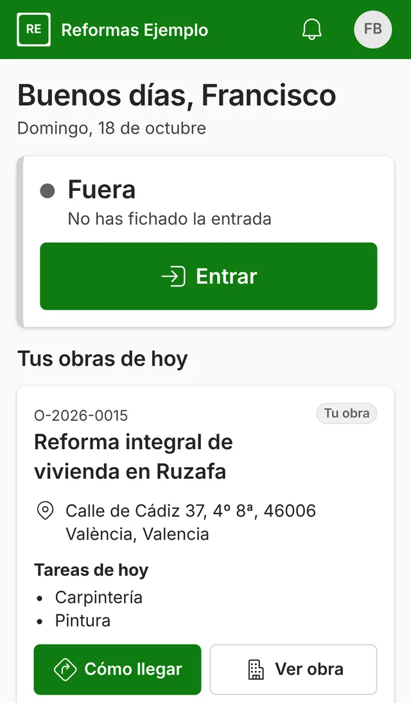
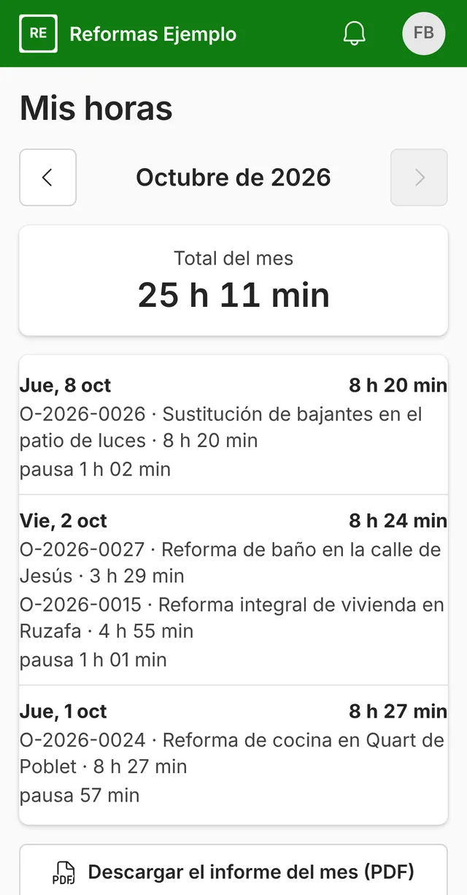

**Desde el 12 de mayo de 2019, toda empresa con trabajadores tiene que registrar cada día la hora de entrada y la de salida de cada persona, y guardar ese registro cuatro años.** Lo dice el [artículo 34.9 del Estatuto de los Trabajadores](https://www.boe.es/buscar/act.php?id=BOE-A-2015-11430). Vale para las empresas de reformas igual que para cualquier otra, también cuando la gente empieza y termina la jornada en la obra y no en la oficina.

Hoy la ley no obliga a que el registro sea digital: puede ser en papel. El Gobierno prepara un real decreto para que lo sea, pero a 18 de octubre de 2026 no se ha aprobado ni publicado en el BOE.

## Qué pide la ley hoy

El artículo 34.9 del Estatuto de los Trabajadores, añadido por el [Real Decreto-ley 8/2019](https://www.boe.es/buscar/act.php?id=BOE-A-2019-3481), pide cuatro cosas:

1. **Un registro diario** de la jornada de cada persona trabajadora.
2. **Con la hora concreta de inicio y de fin** de la jornada.
3. **Organizado** por el convenio colectivo, por un acuerdo de empresa o, si no hay ninguno, por decisión de la empresa después de consultar a los representantes de los trabajadores, si los hay.
4. **Guardado durante cuatro años** y a disposición de los trabajadores, de sus representantes y de la Inspección de Trabajo.

La ley no dice cómo tiene que ser el registro. Puede ser una hoja firmada, una aplicación en el móvil o una máquina de fichar. Lo que importa es que sea diario, fiable y que se pueda enseñar cuando lo pidan.

Mira también tu convenio colectivo: puede pedir más detalle, por ejemplo las pausas.

## A quién afecta en una empresa de reformas

| Situación | ¿Hay que registrar la jornada? |
| --- | --- |
| Trabajadores contratados por tu empresa (oficiales, peones, encargados, oficina) | Sí, todos, también a tiempo parcial |
| Autónomo sin trabajadores | No: el registro es de las personas trabajadoras de la empresa |
| Trabajadores de una subcontrata | Los registra su propia empresa, no tú |

## Lo difícil de fichar en una obra

En una oficina, fichar es fácil: hay una puerta y un reloj. En reformas no:

- **La gente va directa a la obra.** No pasa por la nave, así que la máquina de fichar de la oficina no sirve.
- **Un mismo día puede haber dos obras.** Por la mañana un baño y por la tarde una cocina en otro barrio.
- **En muchas obras no hay cobertura.** Un sótano, un garaje, una vivienda vacía sin wifi.
- **Las hojas de papel se pierden o se rellenan el viernes** de memoria, y entonces el registro ya no es fiable.

Por eso, en reformas, lo que mejor funciona suele ser fichar desde el móvil de cada trabajador, en la obra, con un botón.

## Cómo se ve en una app de fichajes

En ModernERP, cada trabajador pulsa «Entrar» en su móvil al llegar a la obra y «Salir» al irse. Queda guardada la hora y la obra. Si en la obra no hay cobertura, el fichaje se guarda y se envía solo cuando vuelve la conexión.

Cada trabajador ve sus horas del mes, día a día y por obra. Desde la oficina ves quién está trabajando hoy, en qué obra y desde qué hora, y a final de mes sacas el informe del registro de jornada en PDF y en Excel. Además, las horas de cada persona se suman al coste de cada obra, así que el registro sirve también para saber si ganas dinero con ella.

Si la aplicación guarda dónde se ficha, la empresa tiene que avisar antes a sus trabajadores de que se registra la ubicación y para qué ([artículo 90 de la Ley Orgánica de Protección de Datos](https://www.boe.es/buscar/act.php?id=BOE-A-2018-16673)). Lo normal es guardarla solo en el momento de fichar, no durante toda la jornada. Es lo que hace ModernERP: pide la ubicación al pulsar el botón y no sigue a nadie durante el día.

## Qué pasa si no se lleva el registro

No llevar el registro de jornada es una infracción grave según el [artículo 7.5 de la Ley sobre Infracciones y Sanciones en el Orden Social](https://www.boe.es/buscar/act.php?id=BOE-A-2000-15060). Las infracciones graves en materia laboral se sancionan con multas de 751 a 7.500 euros (artículo 40.1.b de la misma ley).

## Qué puede cambiar: el registro horario digital

El Ministerio de Trabajo prepara un real decreto para que el registro sea digital y se pueda consultar a distancia. A 18 de octubre de 2026 no se ha aprobado ni publicado en el BOE, así que **no tiene fecha** y no es obligatorio. Cuando se publique, actualizaremos este artículo con lo que cambie.

Mientras tanto, si ya llevas el registro en digital, no tendrás que cambiar de forma de trabajar cuando llegue.

## Fuentes

Consultadas el 18 de octubre de 2026.

- [Estatuto de los Trabajadores](https://www.boe.es/buscar/act.php?id=BOE-A-2015-11430), artículo 34.9 (BOE, texto consolidado).
- [Real Decreto-ley 8/2019](https://www.boe.es/buscar/act.php?id=BOE-A-2019-3481), artículo 10 y disposición final sexta, apartado 4: el registro de jornada se aplica desde los dos meses de su publicación, el 12 de mayo de 2019 (BOE).
- [Ley sobre Infracciones y Sanciones en el Orden Social](https://www.boe.es/buscar/act.php?id=BOE-A-2000-15060), artículos 7.5 y 40.1.b (BOE, texto consolidado).
- [Ley Orgánica 3/2018 de Protección de Datos](https://www.boe.es/buscar/act.php?id=BOE-A-2018-16673), artículo 90 (BOE).
