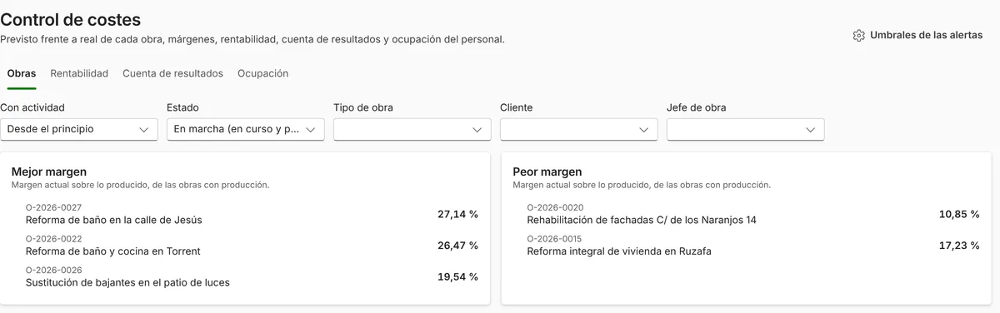

**Excel sirve para presupuestar reformas mientras haces pocos presupuestos, los haces tú solo y no necesitas saber cuánto llevas gastado en cada obra.** Se queda corto cuando empiezas a perder tiempo copiando precios, versiones y datos de un archivo a otro, o cuando terminas una obra sin saber si has ganado dinero con ella.

No hay que cambiar por cambiar. Si tu Excel funciona, sigue con él. Pero si te reconoces en tres o más de las señales de abajo, un programa de presupuestos te ahorrará trabajo.

## Lo bueno del Excel

Hay que reconocerlo: Excel tiene ventajas reales.

- **Ya lo tienes** y sabes usarlo.
- **Es flexible**: puedes montar la plantilla como quieras.
- **Para una obra suelta**, es lo más rápido.

## Seis señales de que se te ha quedado corto

1. **Copias precios de presupuestos viejos.** Cada presupuesto nuevo empieza abriendo uno anterior y cambiando cosas. Si un precio estaba mal o se ha quedado viejo, el error pasa de un presupuesto a otro.
2. **Tienes «presupuesto_final_v3_bueno.xlsx».** El cliente pide cambios y acabas con cinco archivos sin saber cuál aceptó.
3. **Escribes lo mismo tres veces.** Los datos del cliente y de los trabajos se pasan a mano del presupuesto a la hoja de la obra y de ahí a la factura.
4. **No sabes si ganas dinero hasta el final.** Los tickets, las horas de tu gente y las subcontratas están en otro sitio, y nadie los compara con lo presupuestado mientras la obra está en marcha.
5. **Sois varios tocando el mismo archivo.** La oficina, el encargado y tú, cada uno con su copia.
6. **Desde la obra no se puede.** Para consultar un precio o añadir una partida hay que volver a la oficina.

## Qué cambia con un programa de presupuestos

| | Excel | Programa de presupuestos para reformas |
| --- | --- | --- |
| Precios | Copiados de presupuestos anteriores | Un banco de precios único, que se actualiza en un sitio |
| Capítulos y partidas | Los montas tú en cada plantilla | Ya vienen ordenados y el total se calcula solo |
| Cambios del cliente | Un archivo nuevo cada vez | Versiones guardadas dentro del mismo presupuesto |
| Del presupuesto a la obra y a la factura | Copiar y pegar | Un botón, sin volver a escribir |
| Coste real de la obra | En otra hoja, si alguien la rellena | Material, horas y subcontratas sumados al momento |
| Varias personas | Copias del archivo | Cada uno entra con su usuario |
| Móvil | Difícil | Pensado también para el móvil |
| Coste | Ya lo tienes | Una cuota al mes |

Además, con Verifactu, si haces tus facturas con un programa, ese programa tendrá que cumplirlo. Lo explicamos en [Verifactu: ¿2027 o 2028?](/articulos/verifactu-2027-o-2028/).

## Lo que más se nota: saber si ganas dinero con cada obra

De las seis señales, la cuarta es la que más dinero cuesta. Una obra puede ir bien de plazo y mal de dinero: un material que subió, unas horas de más, una subcontrata que no estaba prevista. Si solo lo ves al terminar, ya no hay nada que hacer.

En ModernERP, cada obra suma lo que se gasta de verdad (material, horas de tu gente y subcontratas) y lo compara con lo que presupuestaste. Si una obra empieza a gastar más de lo previsto, te avisa en la pantalla de inicio, a tiempo para corregirlo.

## Cómo cambiar sin perder tus precios

1. **Reúne tu banco de precios.** Aunque esté repartido en varios Excel, junta las partidas que más usas en una sola hoja: descripción, unidad y precio.
2. **Impórtalo al programa.** En ModernERP se puede traer desde Excel o desde archivos BC3, el formato que exportan Presto, Arquímedes o Menfis.
3. **Empieza con la próxima obra, no con las que están a medias.** Las que ya están empezadas, termínalas como las llevabas.
4. **Haz los primeros presupuestos en paralelo.** Uno o dos, en Excel y en el programa, para comprobar que los totales cuadran.

Si quieres ver cómo se hace un presupuesto por partidas, tienes la guía paso a paso en [cómo hacer un presupuesto de reforma por partidas](/articulos/presupuesto-reforma-por-partidas/).

<!-- B -->
ModernERP tiene un mes de prueba gratis, sin tarjeta y sin permanencia. Tus clientes, proveedores, empleados y precios se pasan desde tus Excel con la importación, que te avisa de los errores antes de guardar. El plan Básico cuesta 39 € al mes, con el IVA incluido. Mira los [planes y precios](/#precios) o [pide tu demo](/#demo).
<!-- /B -->
