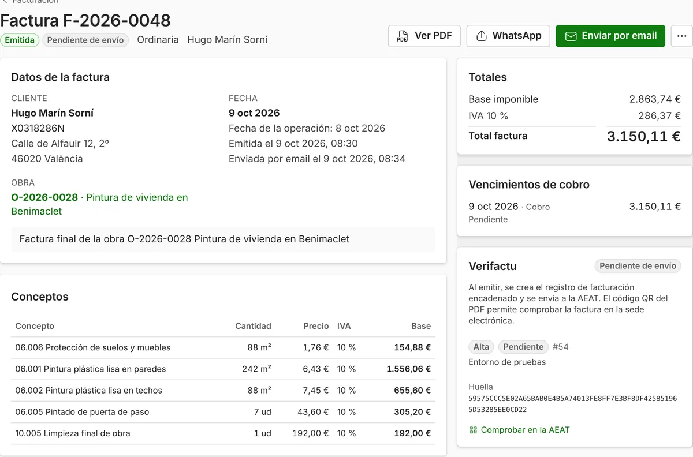

**Una reforma en una vivienda lleva el IVA del 10 % cuando se cumplen tres requisitos a la vez: el cliente es un particular que usa la vivienda para sí (o una comunidad de propietarios), la vivienda se terminó o se rehabilitó hace al menos dos años, y los materiales que pones tú no cuestan más del 40 % de la base imponible. Si falla uno solo, la factura va al 21 %.** Lo dice el [artículo 91.Uno.2.10.º de la Ley del IVA](https://www.boe.es/buscar/act.php?id=BOE-A-1992-28740#a91).

Ojo con las fechas: el [Real Decreto-ley 29/2026](https://www.boe.es/buscar/act.php?id=BOE-A-2026-20823) cambia este artículo **a partir del 1 de diciembre de 2026**, pero todavía tiene que convalidarlo el Congreso. Lo explicamos más abajo. Este artículo recoge el texto del BOE a 27 de octubre de 2026.

## Los tres requisitos del IVA del 10 % en una reforma

Tienen que cumplirse los tres. La ley habla de «ejecuciones de obra de renovación y reparación realizadas en edificios o partes de los mismos destinados a viviendas».

| Requisito | Qué significa en la práctica | Se cumple | No se cumple |
| --- | --- | --- | --- |
| 1. Quién es el cliente | Una persona física que no actúa como empresario o profesional y usa la vivienda para su uso particular. También vale una comunidad de propietarios. | Una familia que reforma el baño de su casa. La comunidad que arregla la fachada. | Una empresa. Un autónomo que reforma su oficina. |
| 2. La antigüedad de la vivienda | La construcción o la rehabilitación de la vivienda terminó al menos dos años antes de empezar la obra. | Un piso de 1995. | Una vivienda entregada hace un año. |
| 3. Los materiales | Tú no pones materiales, o los que pones no cuestan más del 40 % de la base imponible de la obra. | Mano de obra con algo de material. | Una obra en la que casi todo el importe es material. |

Si tu cliente es una empresa, el local es una tienda o una oficina, o la vivienda es nueva, la reforma va al **21 %**.

## Cómo se calcula el 40 % de materiales

La ley compara **el coste de los materiales que aportas** con **la base imponible** de la obra, es decir, lo que cobras sin el IVA. Se usa lo que te cuestan a ti los materiales, no el precio al que los pones en el presupuesto.

| Ejemplo | Base imponible (sin IVA) | Coste de tus materiales | Porcentaje | IVA |
| --- | --: | --: | --: | --- |
| Reforma de baño A | 8.000,00 € | 2.800,00 € | 35 % | 10 % |
| Reforma de baño B | 8.000,00 € | 3.600,00 € | 45 % | 21 % |

En el ejemplo B se pasa del 40 %, así que no se aplica el 10 % a ninguna parte de la obra: **toda la factura va al 21 %**. Importes de ejemplo.

Un consejo práctico: si el cliente compra él mismo los azulejos o los sanitarios, ese material no cuenta como tuyo. Déjalo escrito en el presupuesto.

## Lo que cambia el 1 de diciembre de 2026 (si se convalida)

El [Real Decreto-ley 29/2026, de 6 de octubre](https://www.boe.es/buscar/act.php?id=BOE-A-2026-20823), sobre vivienda, reescribe este artículo con efectos desde el 1 de diciembre de 2026. Los tres requisitos siguen, y hay dos novedades:

1. **Viviendas de alquiler.** El 10 % se aplica también cuando la vivienda se destina a alquilarla como vivienda habitual, «cualquiera que sea la condición del arrendador». Hoy, la reforma que encarga el dueño de un piso alquilado no cumple el requisito del uso particular.
2. **Forma de pago.** El 10 % solo se aplica si el cliente paga con **tarjeta de crédito o débito, transferencia bancaria, cheque nominativo o ingreso en la cuenta** de quien hace la obra. Una reforma cobrada en efectivo iría al 21 %.

**Está pendiente de convalidación.** Un real decreto-ley tiene que convalidarlo el Congreso; como las Cortes están disueltas por las elecciones del 29 de noviembre, lo vota la Diputación Permanente. Si no se convalida, queda derogado y estos cambios no se aplican. Ya pasó con el [Real Decreto-ley 26/2026](https://www.boe.es/buscar/doc.php?id=BOE-A-2026-20266), de contenido parecido, que el Congreso no convalidó a principios de octubre de 2026. Actualizaremos este artículo el día de la votación.

Si cobras anticipos o facturas en diciembre una obra que empezó antes, pregunta a tu gestoría qué tipo aplicar a cada factura.

## Qué conviene guardar de cada obra al 10 %

Si Hacienda revisa una factura al 10 %, tendrás que demostrar que se cumplían los requisitos. Guarda con la obra:

- Una **declaración firmada del cliente** que diga que es un particular, que usa la vivienda para sí y que la vivienda tiene más de dos años.
- El **cálculo del 40 %**: lo que te costaron los materiales que pusiste, con sus facturas de compra.
- Desde el 1 de diciembre de 2026, si se convalida: el **justificante del pago** por banco.

## Cómo lo lleva ModernERP

En ModernERP eliges el **IVA habitual** de tu empresa en la configuración guiada; en reformas de vivienda suele ser el 10 %. Cada concepto del presupuesto y de la factura lleva su IVA, y puedes cambiarlo.

Cuando una factura lleva conceptos al 10 %, sale el enlace **IVA reducido del 10 % en reformas de vivienda**, con los requisitos resumidos. Si el cliente es una empresa o una administración, el programa te avisa al emitir. Lo que **no** hace es calcular el 40 % de materiales: eso depende de tus costes y es responsabilidad tuya. Con el [control de costes de cada obra](/articulos/margen-real-obra-reforma/) tienes a mano lo que has gastado en material.

## Preguntas frecuentes

### ¿Una reforma en un local comercial puede ir al 10 %?

No. El 10 % es para edificios o partes destinados a viviendas. Un local, una oficina o una nave van al 21 %.

### Mi cliente es autónomo. ¿Le puedo aplicar el 10 %?

Sí, si la obra es en su vivienda y la usa para su uso particular, no para su negocio. Si reforma la parte de la casa donde trabaja o su oficina, va al 21 %.

### ¿Y si la obra es en una comunidad de propietarios?

Las obras de renovación y reparación que encarga la comunidad de propietarios también pueden ir al 10 %, con los mismos requisitos de antigüedad y de materiales.

### ¿Puedo cobrar en efectivo una reforma al 10 %?

Hoy, la ley no pone condiciones a la forma de pago. Desde el 1 de diciembre de 2026, si se convalida el Real Decreto-ley 29/2026, el 10 % solo valdrá si te pagan por tarjeta, transferencia, cheque nominativo o ingreso en tu cuenta.

### ¿Y una vivienda nueva o una obra de rehabilitación completa?

La vivienda tiene que tener al menos dos años desde que se terminó o se rehabilitó. La construcción o la rehabilitación de edificios de viviendas contratada directamente por el promotor tiene su propia regla (artículo 91.Uno.3.1.º), que no tratamos aquí.

---

**Fuentes** (consultadas el 27 de octubre de 2026): [Ley 37/1992 del IVA, texto consolidado, artículo 91](https://www.boe.es/buscar/act.php?id=BOE-A-1992-28740#a91) (última actualización publicada el 7 de octubre de 2026); [Real Decreto-ley 29/2026, de 6 de octubre, artículo 7](https://www.boe.es/buscar/act.php?id=BOE-A-2026-20823). Este artículo explica la norma de forma general y no sustituye el consejo de tu gestoría para cada caso.
