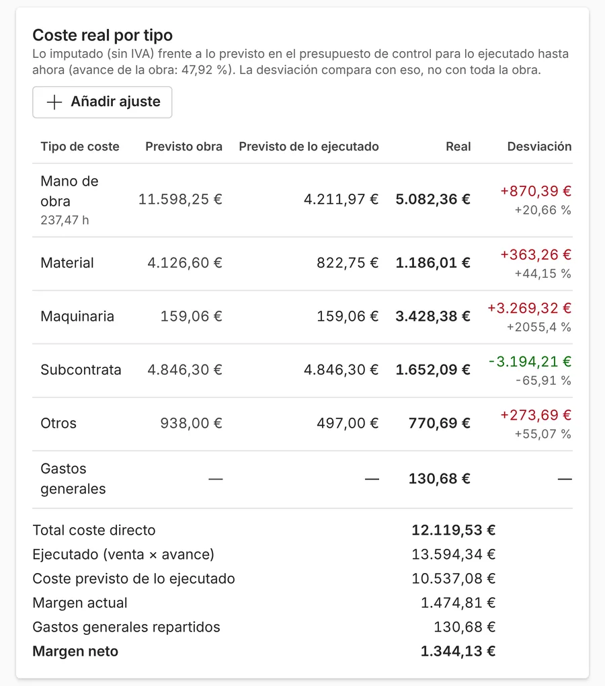

**El margen real de una obra es lo que has producido menos lo que te ha costado de verdad.** No es lo mismo que el margen del presupuesto: ese es lo que esperabas ganar. Para saber si una obra va bien mientras está en marcha, compara lo que llevas hecho (en euros de venta) con lo que llevas gastado en mano de obra, material, maquinaria y subcontratas.

Muchas empresas de reformas solo hacen esta cuenta al terminar la obra, cuando ya no se puede corregir nada. Hacerla cada semana es lo que permite reaccionar a tiempo.

## Margen previsto y margen real

| | Qué es | Cuándo se sabe |
| --- | --- | --- |
| Margen previsto | Lo que vendes menos lo que calculaste que te costaría | Al hacer el presupuesto |
| Margen real (o actual) | Lo que llevas hecho menos lo que llevas gastado | En cualquier momento de la obra |
| Margen neto | El margen real menos la parte de los gastos generales que le toca a la obra | Cuando repartes los gastos generales |

## Las cinco cifras que necesitas

1. **Venta prevista**: el presupuesto aceptado más los extras aprobados.
2. **Avance de cada partida**: qué parte de cada trabajo está hecha (por ejemplo, el alicatado al 60 %).
3. **Producción**: para cada partida, su importe de venta por su avance. Es lo que llevas hecho, en euros.
4. **Coste real**: lo que llevas gastado en la obra: horas de tu gente por lo que te cuesta cada hora, material, maquinaria, subcontratas y otros gastos.
5. **Coste previsto de lo hecho**: lo que *debería* haber costado lo que llevas hecho, según el presupuesto.

Con eso salen dos cuentas:

- **Margen real** = producción − coste real.
- **Desviación** = coste real − coste previsto de lo hecho. Si es positiva, estás gastando más de lo previsto.

## Un ejemplo: reforma de un baño

Datos de ejemplo, inventados. Sin IVA.

| Concepto | Importe |
| --- | --: |
| Venta prevista | 10.000 € |
| Coste previsto | 7.500 € |
| **Margen previsto** | **2.500 € (25 % de la venta)** |

A mitad de obra:

| Concepto | Importe |
| --- | --: |
| Producción (lo hecho, en euros de venta) | 6.000 € |
| Coste previsto de lo hecho | 4.500 € |
| Coste real | 5.000 € |
| Desviación | +500 € (un 11,1 % más de lo previsto) |
| **Margen real** | **1.000 € (16,7 % de lo producido)** |

La obra va bien de plazo y deja dinero, pero mucho menos del previsto: el margen ha bajado del 25 % al 16,7 %. Si nadie lo mira hasta el final, esa diferencia se pierde. Si se mira esta semana, hay tiempo de buscar la causa: unas horas de más, un material que subió o una partida mal medida.

## El error que se come el beneficio: margen y recargo no son lo mismo

Si un trabajo te cuesta 75 € y quieres ganar un 25 %, mucha gente le suma un 25 % al coste: 75 × 1,25 = 93,75 €. Pero así el margen sobre la venta es solo del 20 % (18,75 € de 93,75 €).

Para ganar de verdad un 25 % sobre la venta, hay que dividir: 75 ÷ 0,75 = 100 €.

| Coste | Cuenta | Precio | Margen sobre la venta |
| --: | --- | --: | --: |
| 75 € | Coste + 25 % | 93,75 € | 20 % |
| 75 € | Coste ÷ 0,75 | 100,00 € | 25 % |

En una obra de 10.000 € de coste, esa diferencia son más de 800 € de beneficio que se quedan por el camino.

## Por qué la cuenta sale mal aunque la hagas

- **Las horas no se apuntan por obra.** Si tu gente ficha, pero no se sabe en qué obra estuvo, la mano de obra no se puede cargar a cada obra.
- **Los tickets llegan tarde.** El material comprado en el almacén aparece semanas después, cuando alguien encuentra el ticket en la furgoneta.
- **El avance no se actualiza.** Si los costes entran y el avance no, la obra parece que pierde dinero sin perderlo.
- **Los extras se hacen de palabra.** Se gastan horas y material en algo que no está en la venta prevista.

## Calcula también tu producción mínima

Además del margen de cada obra, conviene saber cuánta obra necesitas hacer al mes para cubrir la estructura. Suma los gastos fijos de un mes (oficina, furgonetas, seguros, sueldos que no van a ninguna obra) y divide por tu margen en porcentaje.

Con 5.500 € de gastos fijos al mes y un margen del 25 %, necesitas unos 22.000 € de producción al mes solo para no perder dinero (5.500 ÷ 0,25).

## Cómo se ve en un programa de gestión

En ModernERP, cada obra suma sola lo que se gasta: las horas que fichan tus trabajadores en esa obra, los tickets y facturas de material y las subcontratas. Lo compara con lo previsto para lo que llevas hecho y te enseña el margen actual y la desviación por tipo de coste. Si una obra empieza a gastar más de lo previsto, te avisa en la pantalla de inicio.

Si todavía haces los presupuestos en Excel, en [cuándo se queda corto el Excel](/articulos/excel-o-programa-de-presupuestos/) explicamos qué cambia. Y para que el margen previsto sea fiable desde el principio, la guía de [cómo hacer un presupuesto de reforma por partidas](/articulos/presupuesto-reforma-por-partidas/).
