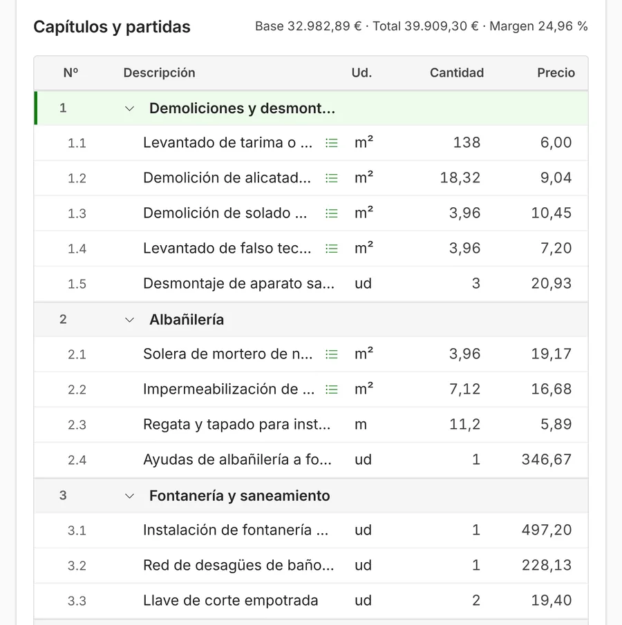

**Un presupuesto de reforma por partidas divide la obra en capítulos (demoliciones, fontanería, alicatado…) y cada capítulo en partidas.** Cada partida es un trabajo concreto con su unidad, su medición y su precio unitario. Multiplicando la medición por el precio sale el importe de cada partida, y la suma de todas es el total de la obra, al que se añade el IVA.

Presupuestar así tiene dos ventajas. El cliente ve qué paga y puede comparar con otras ofertas. Y tú sabes cuánto vale cada parte de la obra, así que cuando el cliente pide un cambio, sabes exactamente qué cambia en el precio.

## Qué es una partida

Una partida es un trabajo que se puede medir. Por ejemplo, «Alicatado de paredes con azulejo cerámico de 30 × 60 cm, recibido con cemento cola, incluso cortes y rejuntado», medido en metros cuadrados.

Cada partida lleva cuatro cosas:

- **La descripción**, que dice qué incluye y qué no. Es lo que evita discusiones al final de la obra.
- **La unidad**: m² (superficie), m (longitud), ud (unidades), h (horas) o kg.
- **La medición**: cuántas unidades hay en esta obra.
- **El precio unitario**: lo que cobras por cada unidad.

## Cómo se calcula el precio unitario

El precio de una partida no es lo que cuesta el material. Hay que sumar todo lo que cuesta hacer una unidad de ese trabajo:

| Concepto | Qué incluye |
| --- | --- |
| Mano de obra | Las horas de tu gente para hacer una unidad, por lo que te cuesta cada hora (sueldo y Seguridad Social). |
| Materiales | Lo que se gasta en una unidad, con las mermas y los cortes. |
| Maquinaria y medios auxiliares | Herramientas, andamios, contenedores, combustible. |
| Costes indirectos | La parte de la oficina, la furgoneta, los seguros y los imprevistos. |
| Beneficio | Lo que quieres ganar. |

En la obra pública, el reglamento de contratos del Estado separa los costes así: directos (mano de obra, materiales y maquinaria) e indirectos ([Real Decreto 1098/2001, artículo 130](https://www.boe.es/buscar/act.php?id=BOE-A-2001-19995)). Y sobre la suma de las partidas añade del 13 al 17 % de gastos generales y un 6 % de beneficio industrial (artículo 131). En una reforma privada no hay una regla fija: puedes meter los gastos generales y el beneficio dentro de cada precio unitario o ponerlos aparte al final. Lo importante es que estén en algún sitio.

## Cómo se hace, paso a paso

1. **Visita la obra y mide.** Paredes, suelos, techos, metros de tubería, puntos de luz. Apunta también lo que no se ve a primera vista: el estado de las bajantes, el cuadro eléctrico, las humedades.
2. **Ordena los trabajos por capítulos**, en el orden en que se hacen en la obra: demoliciones, albañilería, fontanería, electricidad, revestimientos, carpintería, pintura y limpieza.
3. **Elige cada partida de tu banco de precios.** Si no tienes uno, empieza por las 30 o 40 partidas que más repites y ve añadiendo.
4. **Pon la medición de cada partida.** El programa o la hoja de cálculo multiplica por el precio.
5. **Añade lo que siempre se olvida**: protección de suelos y muebles, retirada de escombros y contenedor, ayudas de albañilería a otros gremios y limpieza final.
6. **Revisa el total de cada capítulo.** Si un capítulo te parece caro o barato comparado con otras obras parecidas, busca el error antes de enviarlo.
7. **Escribe las condiciones**: forma de pago, plazo de ejecución, validez del presupuesto y qué no incluye.

## Un ejemplo completo: reforma de un baño

Datos de ejemplo, inventados. Precios sin IVA.

| Capítulo | Partida | Medición | Precio unitario | Importe |
| --- | --- | --: | --: | --: |
| 1. Demoliciones | Picado de alicatado de paredes | 18 m² | 9,50 € | 171,00 € |
| 1. Demoliciones | Levantado de solado | 4 m² | 10,00 € | 40,00 € |
| 1. Demoliciones | Desmontaje de aparatos sanitarios | 3 ud | 21,00 € | 63,00 € |
| 1. Demoliciones | Contenedor y retirada de escombros | 1 ud | 180,00 € | 180,00 € |
| 2. Fontanería | Instalación de agua fría y caliente del baño | 1 ud | 495,00 € | 495,00 € |
| 2. Fontanería | Red de desagües del baño | 1 ud | 228,00 € | 228,00 € |
| 3. Revestimientos | Alicatado de paredes | 18 m² | 32,00 € | 576,00 € |
| 3. Revestimientos | Solado con baldosa cerámica | 4 m² | 38,00 € | 152,00 € |
| 4. Sanitarios y acabados | Colocación de plato de ducha | 1 ud | 320,00 € | 320,00 € |
| 4. Sanitarios y acabados | Pintura plástica en techo | 4 m² | 9,00 € | 36,00 € |

Por capítulos:

| Capítulo | Importe |
| --- | --: |
| 1. Demoliciones | 454,00 € |
| 2. Fontanería | 723,00 € |
| 3. Revestimientos | 728,00 € |
| 4. Sanitarios y acabados | 356,00 € |
| **Total sin IVA** | **2.261,00 €** |

Al total se le suma el IVA que corresponda a esa obra.

## Los errores más comunes

- **Partidas alzadas para todo.** «Fontanería del baño: 700 €» no dice qué incluye. Si el cliente pide un punto de agua más, no tienes con qué justificar el precio.
- **Descripciones cortas.** «Alicatado» sin decir el tamaño de la pieza, quién pone el material o si incluye el rejuntado acaba en discusión.
- **Copiar precios de un presupuesto viejo.** Los materiales suben, y un precio de hace dos años puede comerse el margen.
- **No guardar las versiones.** Si el cliente pide cambios, guarda cada versión. Así sabes qué aceptó y qué no.
- **No apuntar los extras.** Lo que el cliente pide a mitad de obra se presupuesta igual que el resto y se firma antes de hacerlo.

## Cómo se ve en un programa de presupuestos

En ModernERP eliges las partidas de tu banco de precios, pones las mediciones y el programa calcula el total de cada capítulo y el margen del presupuesto. Si cambias un presupuesto después de enviarlo, se guarda como una versión nueva. Y cuando el cliente lo acepta, lo conviertes en obra con un botón, sin volver a escribir nada. Puedes traer tu banco de precios desde Excel o desde archivos BC3, el formato que exportan Presto, Arquímedes o Menfis.

Si todavía presupuestas en Excel, en [cuándo se queda corto el Excel](/articulos/excel-o-programa-de-presupuestos/) explicamos cuándo merece la pena cambiar.

## Fuentes

Consultadas el 18 de octubre de 2026.

- [Real Decreto 1098/2001](https://www.boe.es/buscar/act.php?id=BOE-A-2001-19995), Reglamento general de la Ley de Contratos de las Administraciones Públicas, artículos 130 y 131 (BOE).
