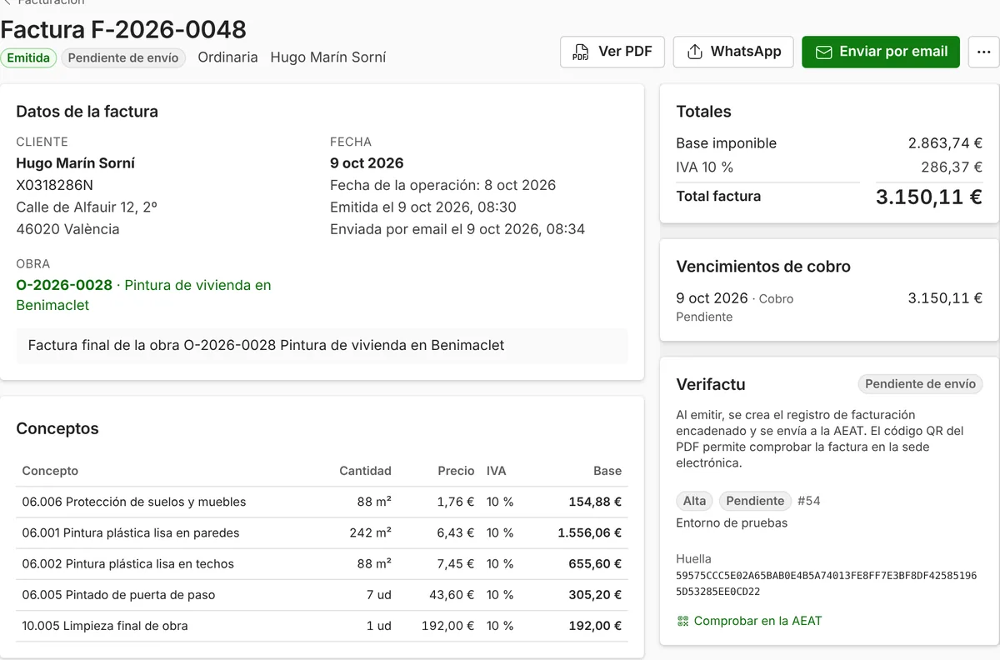

**Verifactu será obligatorio desde el 6 de octubre de 2028, para sociedades y autónomos.** Lo fija el Real Decreto-ley 43/2026, publicado en el BOE el 25 de noviembre de 2026, que retrasa las fechas de 2027.

Con esto se acaba la duda: las fechas de 2027 (el 1 de enero para las sociedades y el 1 de julio para los demás) ya no valen. Una empresa de reformas tiene más margen para prepararse, pero no conviene dejarlo para el final. El real decreto-ley tiene que convalidarlo el Congreso. Si cambia algo, actualizaremos este artículo.

## La fecha, en una tabla

Actualizado el 28 de noviembre de 2026.

| Quién | Antes (Real Decreto-ley 15/2025) | Ahora (Real Decreto-ley 43/2026) |
| --- | --- | --- |
| Sociedades (S.L., S.A.) | 1 de enero de 2027 | 6 de octubre de 2028 |
| Autónomos y demás | 1 de julio de 2027 | 6 de octubre de 2028 |

País Vasco y Navarra tienen su propio sistema.

## Qué es Verifactu, en pocas palabras

Verifactu es el sistema que exige Hacienda para que los programas de facturación guarden cada factura de forma que no se pueda cambiar ni borrar sin dejar rastro. Lo regula el [Real Decreto 1007/2023](https://www.boe.es/buscar/act.php?id=BOE-A-2023-24840).

Para una empresa de reformas, cambia tres cosas del día a día:

1. **Las facturas llevan un código QR** con el que tu cliente puede comprobar en la web de Hacienda que la factura existe.
2. **Si una factura tiene un error, no se borra**: se rectifica o se anula, y queda constancia.
3. **Con la modalidad VERI\*FACTU, cada factura se envía a Hacienda en el momento en que se hace.**

## A quién afecta

Si haces tus facturas con un programa, en el ordenador o en el móvil, ese programa tendrá que cumplir Verifactu. Da igual que seas una sociedad con veinte personas o un autónomo que hace baños.

No afecta a quien factura solo a mano, en papel, ni a las empresas que ya están en el SII (el Suministro Inmediato de Información del IVA).

## Por qué se aplaza

Para que Verifactu y la factura electrónica entre empresas lleguen a la vez, y las empresas se adapten una sola vez. El Real Decreto-ley 43/2026 une la fecha de Verifactu a la del Real Decreto 238/2026, que regula la factura electrónica entre empresas: será obligatoria desde el 6 de octubre de 2027 para quien factura más de 8 millones de euros al año y desde el 6 de octubre de 2028 para el resto.

## Qué conviene hacer ya

1. **Mira cómo facturas hoy.** Si usas un programa, pregunta a quien te lo vende si ha firmado la declaración responsable de Verifactu para la versión que usas. Es el documento con el que el fabricante declara que el programa cumple.
2. **Desconfía de la palabra «homologado».** Verifactu no tiene homologación: Hacienda no aprueba programas. El fabricante declara, bajo su responsabilidad, que el suyo cumple.
3. **Ten a mano tu certificado digital.** Es lo que permite que el programa envíe las facturas a Hacienda en tu nombre.
4. **Prueba con tiempo.** Cambiar de programa a mitad de una obra, con certificaciones y anticipos pendientes, es lo que más problemas da. Mejor hacerlo en un mes tranquilo.
5. **Haz rectificativas, no borres.** Acostúmbrate ya a corregir los errores con una factura rectificativa. Con Verifactu no se puede borrar: se rectifica o se anula.

La ley prevé sanciones para quien use programas que no cumplan. Pero el motivo para prepararse no es el miedo: es no tener que cambiar de forma de trabajar con prisas.

## Cómo se ve una factura con Verifactu

En la factura se ve si ya se ha enviado a Hacienda y si la ha aceptado, la huella que la encadena con la anterior y el enlace para comprobarla en la web de la Agencia Tributaria.

<!-- B -->
**ModernERP cumple Verifactu.** Funciona en la modalidad VERI\*FACTU: subes tu certificado digital una vez y cada factura se envía sola a Hacienda al momento, con su código QR. [Ver la declaración responsable](https://erp.modern-erp.es/declaracion-responsable)

Ya puedes empezar a facturar con Verifactu, antes de que sea obligatorio. Te lo dejamos funcionando: [regístrate](/articulos/como-darse-de-alta-en-modernerp/) y elige tu cita. Sin coste para los 15 primeros clientes, mientras queden plazas.
<!-- /B -->

## Fuentes

Consultadas el 28 de noviembre de 2026.

- [Real Decreto-ley 43/2026](https://www.boe.es/diario_boe/txt.php?id=BOE-A-2026-24701), disposición final primera, que cambia la fecha de Verifactu (BOE del 25 de noviembre de 2026).
- [Real Decreto 1007/2023](https://www.boe.es/buscar/act.php?id=BOE-A-2023-24840), el reglamento de Verifactu (BOE).
- [Orden HAC/1028/2026](https://www.boe.es/boe/dias/2026/10/05/pdfs/BOE-A-2026-20587.pdf), sobre la factura electrónica (BOE del 5 de octubre de 2026).
